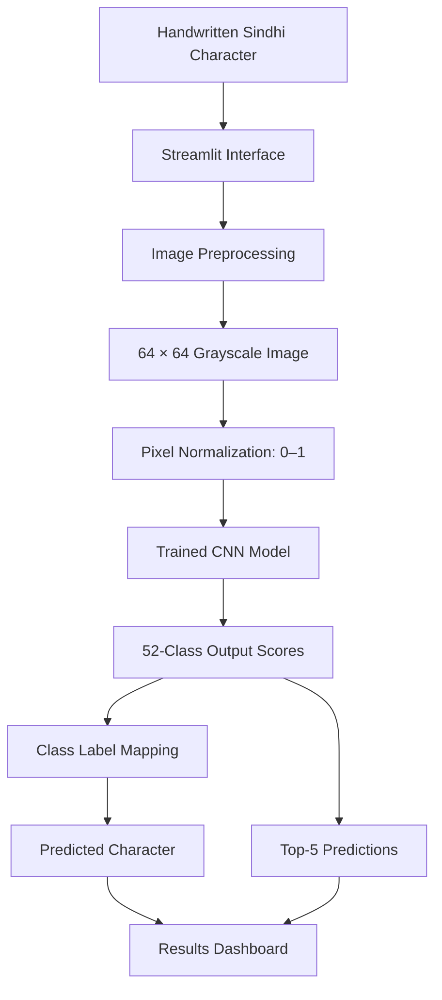

# SindhiNet: A Deep Convolutional Neural Network for Sindhi Handwritten Alphabet Recognition

SindhiNet uses a deep convolutional neural network (CNN) to recognize handwritten Sindhi alphabet characters from images. The project combines deep learning, image preprocessing, multiclass classification, and interactive web application development to explore character recognition for a regional language.

---

## Project Overview

Handwritten character recognition is an important application of computer vision and optical character recognition (OCR). Differences in handwriting styles, character shapes, and image quality make accurate recognition challenging.

SindhiNet addresses this problem by applying a deep CNN to classify handwritten Sindhi characters into **52 output classes**. A Streamlit interface allows users to upload an image, inspect its preprocessed representation, and view the model's predicted character alongside alternative predictions and their confidence scores.

### Key Highlights

- **Deep Learning:** CNN-based image classification using TensorFlow and Keras.
- **52-Class Recognition:** Classification across 52 Sindhi character classes.
- **Image Preprocessing:** Grayscale conversion, resizing, and pixel normalization.
- **Interactive Web Interface:** Image upload, prediction results, and confidence visualization with Streamlit.
- **Model Inference:** Loads a trained Keras model for predictions on new images.
- **End-to-End Workflow:** Connects a trained deep learning model to a usable application.

---
## Application Preview

)
## Features

| Feature | Description |
|---|---|
| Character image upload | Accepts PNG, JPG, JPEG, BMP, and WEBP images |
| Image preprocessing | Converts images to grayscale and resizes them to 64 × 64 pixels |
| Pixel normalization | Scales pixel values from [0, 255] to [0, 1] |
| Character prediction | Predicts a class using the trained CNN |
| Top-5 predictions | Displays the five highest-scoring candidate classes |
| Confidence visualization | Shows model scores using progress bars |
| Full-class inspection | Allows users to explore scores for all 52 classes |
| Interactive GUI | Provides a browser-based interface built with Streamlit |

> **Note:** Model confidence scores are not guarantees of prediction correctness. Actual performance depends on the trained model, the dataset, and the quality of the input image.

---

## System Architecture

The application follows a straightforward inference pipeline:



### Technical Workflow

1. The user uploads an image containing a handwritten character.
2. The application applies the preprocessing pipeline expected by the model.
3. The preprocessed image is passed to the trained CNN.
4. The model produces class scores through its output layer.
5. The application identifies the highest-scoring class and maps its index to a Sindhi character label.
6. The interface displays the prediction, confidence score, and alternative classes.

---

## Model and Image Preprocessing

The application uses a trained Keras model saved in `.keras` format.

**Input specification**

- Image dimensions: `64 × 64`
- Color representation: Grayscale
- Input tensor shape: `(1, 64, 64, 1)`
- Pixel value range: `[0, 1]`
- Output: Scores for 52 character classes

The preprocessing pipeline is implemented as follows:

```python
from PIL import Image, ImageOps
import numpy as np

IMAGE_SIZE = (64, 64)

def preprocess_for_model(image: Image.Image) -> np.ndarray:
    image = ImageOps.exif_transpose(image).convert("L")
    image = image.resize(
        IMAGE_SIZE,
        Image.Resampling.BILINEAR
    )

    array = np.asarray(image, dtype=np.float32) / 255.0

    return array[np.newaxis, ..., np.newaxis]
```

The resulting image tensor is passed to the trained model for inference.

### Prediction and Class Mapping

```python
import numpy as np

probabilities = model.predict(image_tensor, verbose=0)[0]

predicted_index = int(np.argmax(probabilities))
predicted_character = class_names[predicted_index]
confidence = float(probabilities[predicted_index])

print("Predicted character:", predicted_character)
print("Model score:", f"{confidence:.2%}")
```

The `class_names.json` file maps the model's output indices to the corresponding Sindhi character labels. Its ordering must match the class ordering used during training.

---

## Technology Stack

| Technology | Purpose |
|---|---|
| Python | Core programming language |
| TensorFlow | Deep learning framework |
| Keras | Model loading and inference |
| NumPy | Numerical operations and tensor preprocessing |
| Pillow (PIL) | Image loading and transformation |
| Streamlit | Interactive web application |
| JSON | Character class-label mapping |
| Git and GitHub | Version control and project documentation |

---

## Project Structure

```text
SindhiNet/
├── app.py
├── best_sindhi_ocr_model.keras
├── class_names.json
├── requirements.txt
├── README.md
└── .gitignore
```

| File | Description |
|---|---|
| `app.py` | Streamlit application, preprocessing, and inference logic |
| `best_sindhi_ocr_model.keras` | Trained CNN model checkpoint |
| `class_names.json` | Mapping of model output indices to character labels |
| `requirements.txt` | Python dependency list |
| `README.md` | Project documentation |
| `.gitignore` | Excludes virtual environments, caches, and other unnecessary files |

The training notebook and dataset can be maintained separately from the inference application.

---

## Installation and Setup

### Prerequisites

- Python 3.10 or 3.11 recommended
- Git
- Visual Studio Code or another Python-compatible editor

TensorFlow compatibility depends on your Python version and operating system.

### 1. Clone the repository

Replace `YOUR_USERNAME` with your GitHub username.

```bash
git clone https://github.com/YOUR_USERNAME/SindhiNet.git
cd SindhiNet
```

### 2. Create a virtual environment

**Windows — PowerShell**

```powershell
python -m venv .venv
.\.venv\Scripts\Activate.ps1
```

**macOS/Linux**

```bash
python3 -m venv .venv
source .venv/bin/activate
```

### 3. Install dependencies

```bash
python -m pip install --upgrade pip
pip install -r requirements.txt
```

### 4. Verify the required files

Ensure the following files are present in the same directory as `app.py`:

- `best_sindhi_ocr_model.keras`
- `class_names.json`

The class-label file must contain a JSON list whose length and ordering match the model's output classes.

### 5. Launch the application

```bash
python -m streamlit run app.py
```

Open the local URL displayed in the terminal, usually:

```text
http://localhost:8501
```

---

## Using the Application

1. Open SindhiNet in your browser.
2. Upload an image containing one handwritten Sindhi character.
3. Inspect the uploaded image and the 64 × 64 grayscale model input.
4. Click **Recognize character**.
5. Review the predicted character and its model confidence score.
6. Compare the top-five candidate predictions.
7. Expand the full-class scores to inspect the remaining predictions.

### Input Recommendations

For more meaningful predictions:

- Use a clear image with sufficient contrast.
- Prefer a single character rather than a full word or sentence.
- Avoid excessively noisy backgrounds.
- Use images that resemble the model's training data.

The application does not perform word-level recognition or full-document OCR.

---

## Potential Applications

SindhiNet demonstrates a workflow that could support further research and development in:

- Sindhi-language OCR research.
- Digitization of handwritten Sindhi educational materials.
- Handwritten character classification experiments.
- Regional-language AI and low-resource language technology.
- Educational demonstrations of computer vision and deep learning.

These are potential applications; their suitability would require additional validation and development.

---

## Limitations

- **Character-level recognition:** The current interface is designed for one character per image, not complete words, sentences, or documents.
- **Image sensitivity:** Handwriting style, image contrast, character positioning, and noise may affect predictions.
- **Training data dependence:** Recognition performance depends on the coverage and quality of the training dataset.
- **Confidence interpretation:** Softmax scores should not be interpreted as calibrated probabilities of correctness.
- **Label consistency:** Incorrect class ordering can cause a valid model output index to display the wrong character.
- **Evaluation:** Accuracy, precision, recall, F1-score, and generalization performance should be reported only after evaluation on an appropriate held-out test set.

---

## Future Improvements

Potential directions for extending SindhiNet include:

- [ ] Evaluate the model on a held-out test dataset.
- [ ] Report accuracy, precision, recall, F1-score, and a confusion matrix.
- [ ] Test generalization across different handwriting styles and image conditions.
- [ ] Add image cropping, background cleanup, and character-centering options.
- [ ] Support batch inference for multiple character images.
- [ ] Develop word-level and line-level Sindhi OCR.
- [ ] Explore data augmentation and alternative CNN architectures.
- [ ] Add an API for integration with other applications.
- [ ] Deploy the application to a publicly accessible hosting platform.

---

## Skills Demonstrated

This project demonstrates practical work with:

- Convolutional Neural Networks (CNNs)
- Deep learning inference with TensorFlow/Keras
- Image preprocessing and numerical data handling
- Multiclass image classification
- Model serialization and loading
- Interactive application development with Streamlit
- Integration of a trained ML model into a user-facing application
- GitHub project organization and documentation

---

## Author

**Sarfraz Ali Katpar**

Computer Science Student | AI/ML Engineer

Interested in Deep Learning, Computer Vision, Natural Language Processing, and AI applications for regional languages.

- **GitHub:** [KatparSarfraz1214](https://github.com/KatparSarfraz1214)
- **LinkedIn:** [Sarfraz Ali Katpar](https://www.linkedin.com/in/sarfraz-ali-katpar/)

---

## Acknowledgements

This project was developed as an exploration of deep learning for Sindhi handwritten character recognition. Recognition performance and real-world applicability should be established through reproducible evaluation and testing.

---

## License

Add a `LICENSE` file to specify how this project may be used, modified, and distributed. Until a license is added, do not assume that the repository grants permission for unrestricted reuse.

---

**SindhiNet — Exploring deep learning for Sindhi handwritten character recognition.**
